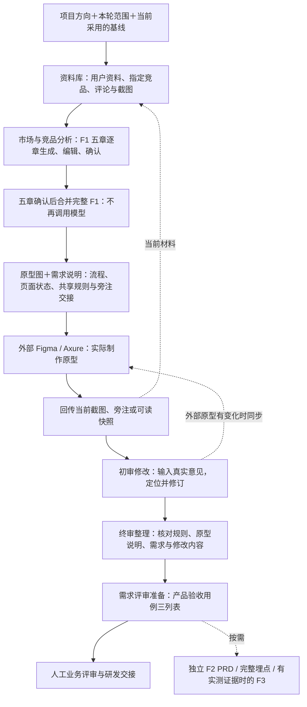
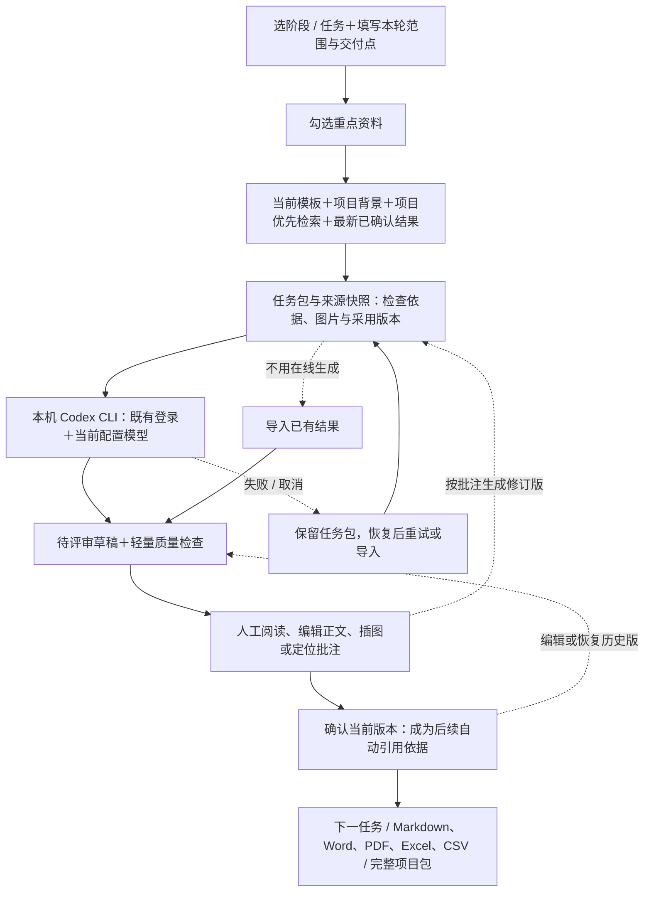

# 工作台整体流程与验证

更新日期：2026-10-21。本页以当前代码为准，说明新品主线、每次生成的处理链路与验证边界。

## 1. 日常新品主线

新品已经决定要做，不设机会门；已有分析、原型或评审意见时，从当前阶段开始，不必重新生成一套文档。

竞品未选定时，先在资料页「找竞品」搜索并手选，再进行采集。选用角色与备注随采集入库，搜索本身不产生项目正文。已有链接仍可直接采集。当前范围的就绪结果可显式批量确认，确认后带资料进入 F1 首章；每章确认后可继续下一章。详见 [竞品发现与新品链路优化](WORKBENCH-COMPETITOR-DISCOVERY-UPDATE.md)。



- 图中是建议协作顺序，不是自动审批状态机。页面允许切换阶段；工作台确认文档不代表公司评审已通过。
- 原型阶段任务为 `shared-rules`、`flow-pages`、`prototype-handoff`；`core-prd` 是需求评审阶段的可选独立 F2，不混称为同一任务。
- 外部原型需要操作者或相应连接器实际执行。本工作台目前不直接写入 Figma/Axure。真实意见没有提供时，不生成虚构审核结论。
- “F2 / 埋点 / F3 可选”指新品预设；版本迭代预设仍包含 PRD 与开发实测。
- 产品验收用例只定义“验收场景｜操作步骤｜预期结果”，不是实测结果表。

## 2. 一次任务的信息流



输入中的用户资料与历史材料只是依据，不是执行指令。项目级资料与当前产品版本优先；跨版本资料需要显式选择。新版草稿未确认时，旧确认稿不自动替代新版；历史分支仍保留供回溯。长文按范围节选，任务包标明读取位置及未覆盖内容，不能当作已读完整原文。

竞品由用户指定，不自动挑选。资料页可调用已配置的桌面采集器，选择国家及评论筛选条件，采集长短描述、基础信息、截图和评论，中文翻译为可选；预览后再导入。粘贴/上传的图片保存在项目资料中，需要正文插图时显式插入。

## 3. Codex 连接与本轮修复

- 入口选择改为：显式 `WORKBENCH_CODEX_BIN` → 显式 `WORKBENCH_CODEX_JS` → PATH 原生 CLI → 默认 npm JavaScript 入口。显式配置无效会提示，不静默回退。
- 旧 npm CLI 0.153.4 对本机配置的 `gpt-6.1-sol` 返回服务端模型不支持；同机桌面 CLI 0.163.0-alpha.10.2 使用同一模型已经完成“流程与页面状态 → 确认 → 产品验收用例 → 确认”两步真实生成。没有更改全局模型或登录。
- 两个 CLI 的 `model/list` 实际列表不同：桌面 CLI 列出了该模型，旧 npm CLI 未列出。列表成功只说明模型发现可用，真实生成结果才证明该任务链路可用。
- 执行使用受限 `codex exec`，不继承任意 MCP/插件/工具。只在运行时继承 provider、reasoning effort、service tier 等白名单连接配置，不读取或复制认证存储到项目。
- 错误从通用失败改为参数、认证、模型、网络、额度五类摘要；stderr 有界脱敏保存。日志与原始 CLI 中间输出不进入完整项目 ZIP；正式交付物与来源快照保留。
- 每次运行使用独立输出文件，避免失败后误读旧结果。取消/超时清理子进程，关闭工作台也会停止采集进程。
- 实跑发现并修复了 `M02` 与 `M02-S01` 被误认为重复编号的问题；仍拦截真正重复的完整 ID。

官方行为依据：[非交互执行](https://learn.chatgpt.com/docs/non-interactive-mode)、[App Server 与 model/list](https://learn.chatgpt.com/docs/app-server)。本机测试结论不等于其他账号、模型或 provider 均已兼容。

## 4. 可重复验证

```powershell
.venv\Scripts\python.exe -m pytest -q
.venv\Scripts\python.exe -X utf8 scripts\workbench_flow_smoke.py
```

`workbench_flow_smoke.py` 使用独立临时项目与固定输出替身，不发送模型请求。覆盖 F1 五章、确认与合并、新任务、定位批注修订、确认后的上下游来源、编辑版本、取消恢复、多格式导出、完整项目迁移及持久化。

真实模型冒烟必须显式开启，会发送人工构造的测试内容并消耗账号额度，不触碰用户现有业务项目：

```powershell
.venv\Scripts\python.exe -X utf8 scripts\workbench_codex_smoke.py --run-real
```

结果保存在忽略目录 `tmp/codex-live-*/smoke-report.json`。它验证有限的生成与确认链路，不代表真实市场分析准确性或整套业务已经自动完成。最新通过数与实跑结果见 [验收记录](../workbench/VERIFICATION.md)。

尚未在本轮执行：真实竞品网络采集、外部原型工具写入、真机验收、Word/PDF 视觉排版与商业效果验证。
